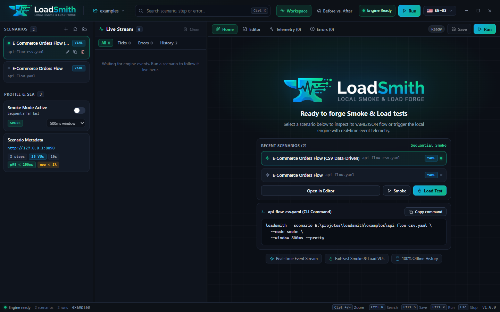
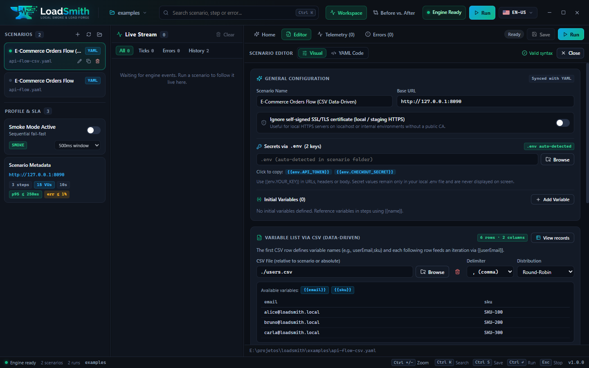
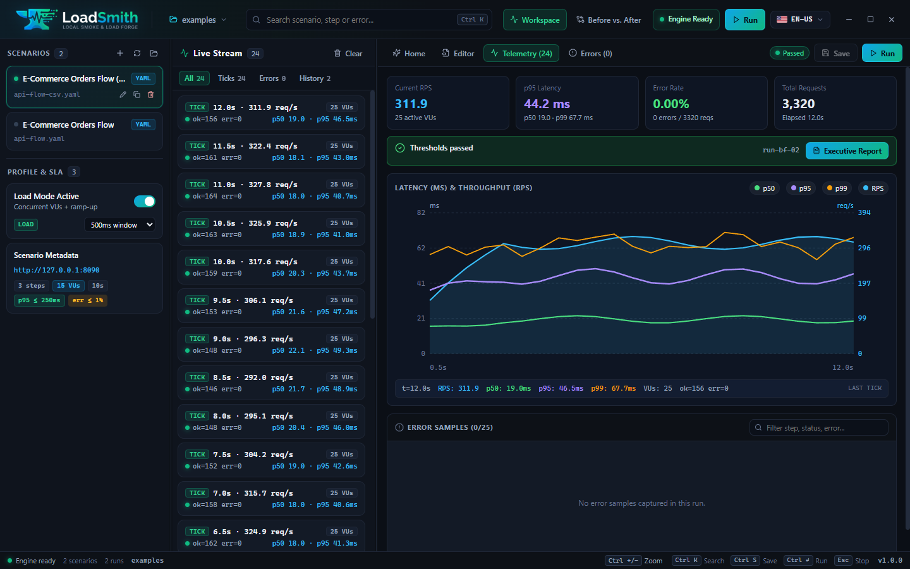
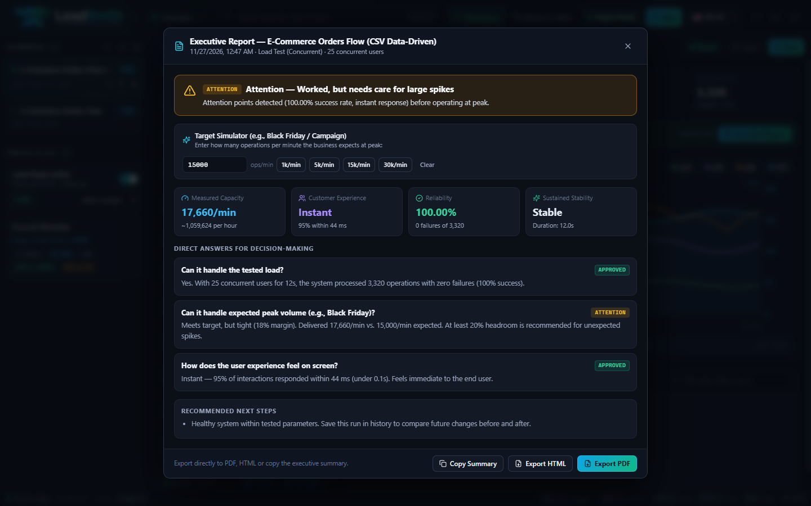

<p align="center">
  
</p>

<p align="center">
  <strong>Local Smoke &amp; Load Forge — Plataforma 100% Offline de Pruebas de Flujo, Carga y Decisión Ejecutiva</strong>
</p>

<p align="center">
  <a href="https://github.com/claudsan/loadsmith/actions/workflows/ci.yml"></a>
  <a href="https://github.com/claudsan/loadsmith/actions/workflows/release.yml"></a>
  <a href="https://github.com/claudsan/loadsmith/actions/workflows/pages.yml"></a>
  <a href="LICENSE"></a>
  
</p>

<p align="center">
  🌐 <a href="README.md">English</a> · <a href="README.pt-BR.md">Português</a> · <strong>Español</strong>
  <br />
  🚀 <a href="https://claudsan.github.io/loadsmith/"><strong>Sitio Oficial y Simulador Interactivo</strong></a> · 🔥 App Hermana: <a href="https://claudsan.github.io/hooksmith/"><strong>Hooksmith</strong></a>
</p>

# LoadSmith — Manual de Uso

**LoadSmith** es una aplicación de escritorio que responde a las tres preguntas que todo equipo se hace antes de un gran lanzamiento:

- *¿Nuestro sistema soporta la carga?*
- *¿Soporta el volumen que esperamos?*
- *¿Se va a caer en el Black Friday?*

Funciona en tu propio ordenador, sin conexión, mantiene tus datos en local y habla en lenguaje claro, para que tanto desarrolladores como gerentes entiendan los resultados.

> 📖 ¿Buscas la documentación técnica/para desarrolladores? Consulta [docs/DEVELOPMENT.md](docs/DEVELOPMENT.md) (en inglés).

---

## Índice

1. [Instalación](#1-instalación)
2. [Tu primera prueba en 5 minutos](#2-tu-primera-prueba-en-5-minutos)
3. [Conociendo la pantalla](#3-conociendo-la-pantalla)
4. [Crear y editar escenarios](#4-crear-y-editar-escenarios)
5. [Variables, archivos CSV y secretos](#5-variables-archivos-csv-y-secretos)
6. [Prueba Smoke vs. prueba de Carga](#6-prueba-smoke-vs-prueba-de-carga)
7. [Leer los resultados](#7-leer-los-resultados)
8. [Historial y Antes vs. Después](#8-historial-y-antes-vs-después)
9. [El Informe Ejecutivo (para gerentes)](#9-el-informe-ejecutivo-para-gerentes)
10. [Idioma, atajos y consejos](#10-idioma-atajos-y-consejos)
11. [Solución de problemas](#11-solución-de-problemas)
12. [App Hermana — Hooksmith](#12-app-hermana--hooksmith)

---

## 1. Instalación

LoadSmith está disponible para **Windows**, **macOS** y **Linux**:

| Plataforma | Paquete | Cuándo usarlo |
| --- | --- | --- |
| **Windows (x64)** | `LoadSmith Setup 1.0.0.exe` / `LoadSmith 1.0.0.exe` | Instalador estándar (Menú Inicio y Escritorio) o versión portátil. |
| **macOS (Apple Silicon e Intel)** | `LoadSmith-1.0.0-arm64.dmg` / `LoadSmith-1.0.0-x64.dmg` (`.zip`) | Imagen nativa para macOS con motor interno universal. |
| **Linux (x64)** | `LoadSmith-1.0.0.AppImage` / `loadsmith_1.0.0_amd64.deb` | `AppImage` universal (`chmod +x`) o paquete `.deb` para Debian/Ubuntu. |

Descárgalos desde la página de **Releases** del proyecto. **No** necesitas instalar Go, Node.js ni nada más.

> **¿Aviso de aplicación sin firma?** Haz clic en **Más información → Ejecutar de todas formas** en Windows SmartScreen, o **Clic derecho → Abrir** en macOS Gatekeeper.

En el primer inicio, LoadSmith crea la carpeta **`Documents/LoadSmith`** con un escenario de ejemplo, para que siempre tengas algo que probar.

---

## 2. Tu primera prueba en 5 minutos



1. **Abre LoadSmith.** El escenario de ejemplo aparece en la columna izquierda.
2. **Apunta a tu API.** Haz clic en **Editor** e indica la **Base URL** (por ejemplo `https://staging.miempresa.com`).
3. **Revisa los pasos.** Cada paso es una petición (p. ej. "iniciar sesión", "crear pedido"). Ajusta las rutas a tu API.
4. **Haz clic en ▶ Ejecutar.** Una ventana de confirmación muestra exactamente qué va a ocurrir: dirección de destino, número de usuarios y duración. Confirma para empezar.
5. **Sigue en vivo.** La pestaña **Telemetría** muestra velocidad, tiempos de respuesta y errores en tiempo real.

Al terminar, haz clic en **Informe Ejecutivo** para obtener un resumen claro y fácil de compartir.

> 💡 **Consejo:** empieza siempre con una ejecución **Smoke** (una pasada rápida por tu flujo) para comprobar que el escenario es correcto y luego cambia a **Carga**.

---

## 3. Conociendo la pantalla

| Área | Qué hace |
| --- | --- |
| **Barra superior** | Búsqueda (`Ctrl K`), carpeta del workspace actual, páginas **Workspace** / **Antes vs. Después**, estado del motor, botón **Ejecutar** y selector de idioma. |
| **Columna izquierda — Escenarios** | Tus archivos de prueba. Crea (**+**), actualiza o abre otra carpeta. Pasa el ratón sobre un escenario para **renombrar**, **duplicar** o **eliminar**. |
| **Columna izquierda — Perfil & SLA** | Alterna entre **Smoke** y **Carga**, elige la ventana de medición y mira el resumen del escenario seleccionado. |
| **Columna central — Live Stream** | Un flujo en vivo de todo lo que ocurre durante la ejecución, además de la pestaña **Historial**. |
| **Área derecha** | Pestañas: **Inicio**, **Editor**, **Telemetría** y **Errores**. |
| **Barra inferior** | Estado del motor, número de escenarios y ejecuciones, zoom y atajos. |

Puedes arrastrar los bordes de las columnas para redimensionarlas. La aplicación recuerda tu diseño.

---

## 4. Crear y editar escenarios

Un **escenario** es una prueba guardada: *a dónde* enviar las peticiones, *qué* enviar y *qué se considera éxito*.

### Crear uno

Haz clic en **+** sobre la lista de escenarios, escribe un nombre de archivo (p. ej. `checkout.yaml`) y elige una plantilla inicial:

- **API REST Simple** — un health check básico.
- **Login + Ruta Autenticada** — inicia sesión, guarda el token y lo usa en la siguiente petición.
- **Carga con Datos CSV** — usa una hoja de usuarios/productos para que cada usuario virtual envíe datos distintos.

### El Editor Visual



Nunca tienes que escribir código. La pestaña **Visual** permite editar todo con formularios; la pestaña **Código** muestra el mismo escenario como texto, y ambas se mantienen sincronizadas.

Para cada **paso** puedes definir:

- **Método y Ruta** — p. ej. `POST /orders`.
- **Headers** — p. ej. un token de autorización.
- **Body** — los datos que envías (JSON o texto plano).
- **Aserciones** — lo que debe cumplirse: estado esperado (p. ej. `200`), texto que debe contener la respuesta o tiempo máximo de respuesta.
- **Extraer** — toma un valor de la respuesta (como el token del login) y reutilízalo en los pasos siguientes como `{{token}}`.

Usa las flechas para reordenar pasos y los iconos de copiar/papelera para duplicarlos o quitarlos.

### Importar desde cURL

¿Ya tienes una petición en Chrome DevTools, Postman o Insomnia? Cópiala como **cURL**, haz clic en **Importar cURL** en la sección de Pasos, pégala y LoadSmith construye el paso por ti: método, dirección, headers y body incluidos.

### Cambios sin guardar

Si intentas cambiar de escenario, de carpeta o cerrar la aplicación con ediciones sin guardar, LoadSmith pregunta si deseas **guardar**, **descartar** o **cancelar**. No se pierde nada por accidente.

---

## 5. Variables, archivos CSV y secretos

### Variables iniciales
Define valores simples (como `userEmail`) y úsalos en cualquier lugar como `{{userEmail}}`.

### Datos en CSV (pruebas realistas)
Los usuarios reales son distintos entre sí. Vincula un **archivo CSV** y cada usuario virtual tomará una fila diferente.

- La **primera línea** nombra las variables (p. ej. `email,sku`).
- Cada línea siguiente es un conjunto de valores.
- Úsalos como `{{email}}` y `{{sku}}`.
- Elige **Secuencial** (en orden) o **Aleatorio**, y el separador de columnas (coma, punto y coma o tabulador).
- Haz clic en **Ver registros** para explorar y buscar en el archivo, y haz clic en el chip de una variable para copiarla.

### Secretos con un archivo `.env`
Nunca escribas contraseñas ni claves de API directamente en el escenario. Ponlas en un archivo llamado `.env` junto a tu escenario:

```
API_TOKEN=mi-valor-secreto
```

LoadSmith lo detecta automáticamente y muestra los **nombres** de tus secretos como chips clicables, como `{{env.API_TOKEN}}`. Los **valores nunca se muestran en pantalla** ni se guardan en el escenario.

### HTTPS con certificados autofirmados
¿Pruebas un servidor local o interno con un certificado propio? Activa **Ignorar certificado SSL/TLS autofirmado**. Úsalo solo en entornos de confianza.

---

## 6. Prueba Smoke vs. prueba de Carga

| | **Smoke** | **Carga** |
| --- | --- | --- |
| **Objetivo** | "¿Mi flujo funciona?" | "¿Aguanta muchos usuarios?" |
| **Cómo se ejecuta** | Un usuario, paso a paso. Se detiene en el primer fallo. | Muchos usuarios virtuales a la vez. |
| **Duración** | Unos segundos | Tú decides |

Ajustes de carga:

- **Virtual Users (VUs)** — cuántos usuarios simulados actúan a la vez.
- **Duración** — cuánto dura la prueba (p. ej. `30s`, `5m`).
- **Ramp-Up** — con qué gradualidad llegan los usuarios (p. ej. `10s`), como una multitud entrando en una tienda.
- **Think Time** — una pausa entre las acciones de cada usuario, para comportarse como una persona.

### Reglas de aprobación (SLA)
Define límites y LoadSmith marcará automáticamente la prueba como **Aprobada** o **Fallida**:

- **p95 máximo** — el 95% de las peticiones debe ser más rápido que esto (en milisegundos).
- **Tasa de error máxima** — el mayor porcentaje de fallos que aceptas.

---

## 7. Leer los resultados



| Número | Qué significa en palabras simples |
| --- | --- |
| **RPS** | Peticiones por segundo: cuán ocupado está el sistema. |
| **p50** | El tiempo de respuesta típico: la mitad de las peticiones es más rápida. |
| **p95** | Casi el peor caso: el 95% de las peticiones es más rápido. El mejor número para juzgar la experiencia del usuario. |
| **p99** | Peor caso realista: solo el 1% de las peticiones es más lento. |
| **Tasa de error** | Porcentaje de peticiones que fallaron. |
| **VUs** | Usuarios simulados activos en este momento. |

La pestaña **Errores** guarda muestras de los fallos (hasta 25), con paso, petición, estado y mensaje: útiles para encontrar dónde se rompe algo.

---

## 8. Historial y Antes vs. Después

Cada ejecución se guarda automáticamente en tu ordenador.

1. Abre **Antes vs. Después** en la barra superior.
2. Elige una ejecución **Antes** (referencia) y una **Después** (objetivo).
3. Mira cómo cambiaron el tiempo de respuesta, el rendimiento, los errores y el total de peticiones — **verde es mejor, rojo es peor** — además de un gráfico superpuesto.

Perfecto para demostrar que una optimización funcionó (o que una versión empeoró el rendimiento).

---

## 9. El Informe Ejecutivo (para gerentes)



Después de cualquier ejecución, haz clic en **Informe Ejecutivo**. Traduce los números a lenguaje de negocio:

- Un **veredicto tipo semáforo**: Aprobado, Atención o Riesgo Alto.
- **Respuestas directas** a: *¿Soporta la carga? ¿Soporta el volumen esperado? ¿Cómo queda la experiencia del cliente?*
- **Tarjetas de negocio**: capacidad por minuto/hora, experiencia del cliente, confiabilidad y estabilidad.
- **Próximos pasos recomendados**.

### El simulador de Black Friday
Indica cuántas operaciones por minuto espera tu negocio en el pico (o usa los atajos 1k / 5k / 15k / 30k). El informe dice si el sistema alcanza la meta, cuánto margen tiene o cuánto le falta.

### Compartir
- **Exportar PDF** — un clic, listo para enviar por correo.
- **Exportar HTML** — se abre en cualquier navegador.
- **Copiar Resumen** — texto plano para chats y correos.

El informe sigue el idioma seleccionado.

---

## 10. Idioma, atajos y consejos

### Idioma
Usa el selector con banderas de la barra superior para alternar entre **English**, **Português** y **Español**. LoadSmith recuerda tu elección.

### Atajos de teclado

| Atajo | Acción |
| --- | --- |
| `Ctrl` + `K` | Buscar escenarios, pasos y errores |
| `Ctrl` + `S` | Guardar el escenario abierto |
| `Ctrl` + `Enter` | Ejecutar (pide confirmación antes) |
| `Esc` | Detener una prueba en curso / cerrar una ventana |
| `Ctrl` + `+` / `-` / `0` | Acercar / alejar / restablecer zoom |

### Buenas prácticas
- Empieza con **Smoke** y luego **Carga**.
- Aumenta los usuarios gradualmente entre ejecuciones para encontrar el punto de ruptura.
- Prueba en **staging**, no en producción, salvo que sepas exactamente lo que haces: una prueba de carga puede ralentizar de verdad el sistema objetivo.
- Ejecuta el mismo escenario antes y después de un cambio y compara en **Antes vs. Después**.

---

## 11. Solución de problemas

| Problema | Qué hacer |
| --- | --- |
| **"Motor no encontrado" / botón Ejecutar deshabilitado** | Reinstala la aplicación. El motor de pruebas viene incluido. |
| **Todo falla con un error de SSL/certificado** | El servidor usa un certificado autofirmado. Activa la opción de certificado autofirmado (solo en entornos de confianza). |
| **"undefined variable"** | Un `{{nombre}}` no tiene valor. Revisa la ortografía, el encabezado del CSV, la clave del `.env` o que un paso anterior la extraiga. |
| **Error de sintaxis en el Editor Visual** | Abre la pestaña **Código**, corrige la línea resaltada y vuelve a **Visual**. |
| **Windows SmartScreen bloquea el instalador** | Haz clic en **Más información → Ejecutar de todas formas**. |

---

## 12. App Hermana — Hooksmith

**LoadSmith** tiene una aplicación hermana de escritorio creada con la misma filosofía local-first, sin nube y en 3 idiomas:

🔥 **[Hooksmith — Local API & Webhook Forge](https://claudsan.github.io/hooksmith/?lang=es)** ([Repositorio en GitHub](https://github.com/claudsan/hooksmith))

- Abre **listeners HTTP y HTTPS** locales con certificados SSL autofirmados automáticos.
- Inspecciona peticiones entrantes, crea **Reglas de Mock** con retraso configurable y dispara **callbacks asíncronos automáticos**.
- **Flujo combinado:** simula pasarelas externas en **Hooksmith** durante el desarrollo y usa **LoadSmith** para validar el flujo completo y medir su capacidad bajo carga 100% offline.

---

## Licencia

MIT — consulta [LICENSE](LICENSE). Las notas de versión están en [CHANGELOG.md](CHANGELOG.md).
