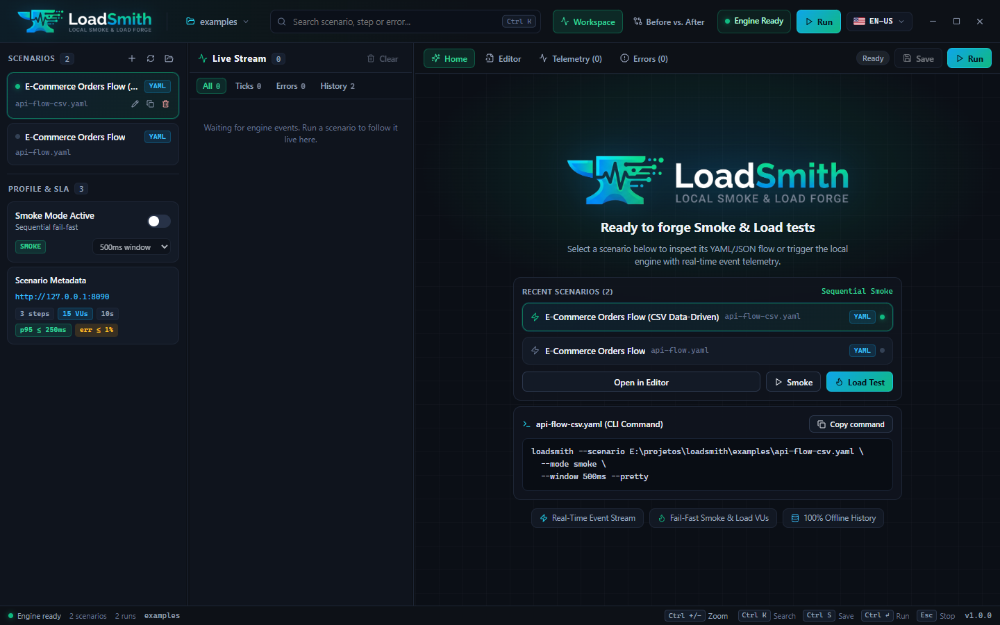
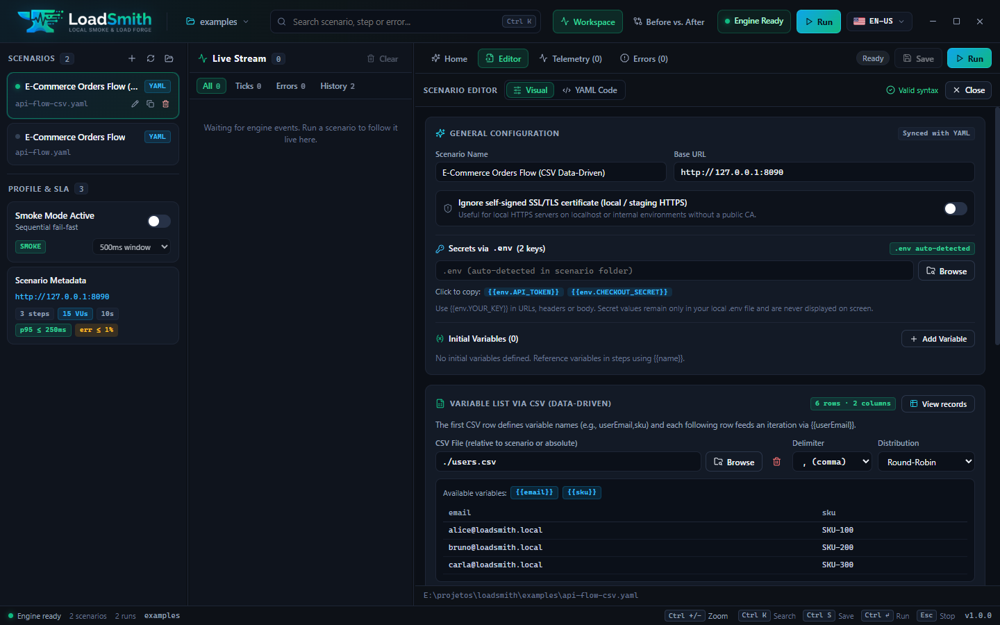
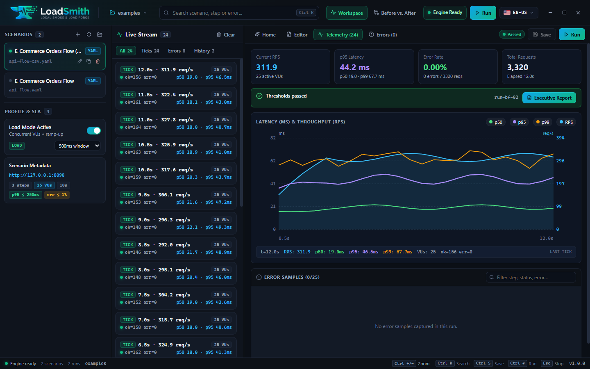
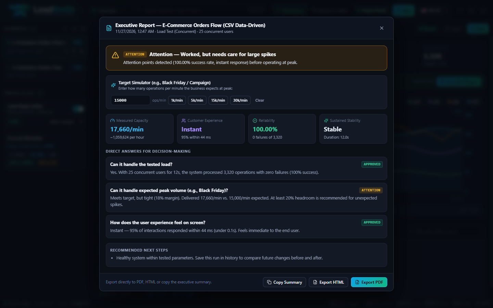

<p align="center">
  
</p>

<p align="center">
  <strong>Local Smoke &amp; Load Forge — 100% Offline, Privacy-First API Stress &amp; Decision Platform</strong>
</p>

<p align="center">
  <a href="https://github.com/claudsan/loadsmith/actions/workflows/ci.yml"></a>
  <a href="https://github.com/claudsan/loadsmith/actions/workflows/release.yml"></a>
  <a href="https://github.com/claudsan/loadsmith/actions/workflows/pages.yml"></a>
  <a href="LICENSE"></a>
  
</p>

<p align="center">
  🌐 <strong>English</strong> · <a href="README.pt-BR.md">Português</a> · <a href="README.es-ES.md">Español</a>
  <br />
  🚀 <a href="https://claudsan.github.io/loadsmith/"><strong>Official Website &amp; Interactive Simulator</strong></a> · 🔥 Sibling App: <a href="https://claudsan.github.io/hooksmith/"><strong>Hooksmith</strong></a>
</p>

# LoadSmith — User Manual

**LoadSmith** is a desktop app that answers three questions every team asks before a big launch:

- *Does our system handle the load?*
- *Does it handle the volume we expect?*
- *Will it go down on Black Friday?*

It runs on your own computer, works offline, keeps your data local, and speaks in plain language — so both developers and managers can understand the results.

> 📖 Looking for the technical/developer documentation? See [docs/DEVELOPMENT.md](docs/DEVELOPMENT.md).

---

## Table of Contents

1. [Install](#1-install)
2. [Your first test in 5 minutes](#2-your-first-test-in-5-minutes)
3. [Getting around the screen](#3-getting-around-the-screen)
4. [Creating and editing scenarios](#4-creating-and-editing-scenarios)
5. [Using variables, CSV files and secrets](#5-using-variables-csv-files-and-secrets)
6. [Smoke test vs. Load test](#6-smoke-test-vs-load-test)
7. [Reading the results](#7-reading-the-results)
8. [History and Before vs. After](#8-history-and-before-vs-after)
9. [The Executive Report (for managers)](#9-the-executive-report-for-managers)
10. [Language, shortcuts and tips](#10-language-shortcuts-and-tips)
11. [Troubleshooting](#11-troubleshooting)
12. [Sibling App — Hooksmith](#12-sibling-app--hooksmith)

---

## 1. Install

LoadSmith is available for **Windows**, **macOS** and **Linux**:

| Platform | Package | When to use it |
| --- | --- | --- |
| **Windows (x64)** | `LoadSmith Setup 1.0.0.exe` / `LoadSmith 1.0.0.exe` | Installer (Start Menu & Desktop shortcuts) or standalone Portable `.exe`. |
| **macOS (Apple Silicon & Intel)** | `LoadSmith-1.0.0-arm64.dmg` / `LoadSmith-1.0.0-x64.dmg` (`.zip`) | Drag-and-drop macOS bundle with Universal internal engine. |
| **Linux (x64)** | `LoadSmith-1.0.0.AppImage` / `loadsmith_1.0.0_amd64.deb` | Universal `AppImage` (`chmod +x`) or Debian/Ubuntu `.deb` package. |

Download them from the project's **Releases** page. You do **not** need to install Go, Node.js or anything else.

> **Unsigned app notice?** Click **More info → Run anyway** on Windows SmartScreen, or **Right-click → Open** on macOS Gatekeeper.

On first launch, LoadSmith creates a folder called **`Documents/LoadSmith`** with an example scenario, so you always have something to try.

---

## 2. Your first test in 5 minutes



1. **Open LoadSmith.** The example scenario appears in the left column.
2. **Point it to your API.** Click **Editor**, then set the **Base URL** (for example `https://staging.mycompany.com`).
3. **Check the steps.** Each step is one request (e.g. "log in", "create order"). Adjust the paths to match your API.
4. **Click ▶ Run.** A confirmation window shows exactly what will happen — target address, number of users, duration. Confirm to start.
5. **Watch live.** The **Telemetry** tab shows speed, response times and errors in real time.

When it finishes, click **Executive Report** to get a clear, shareable summary.

> 💡 **Tip:** always start with a **Smoke** run (one quick pass through your flow) to make sure the scenario is correct, then switch to **Load**.

---

## 3. Getting around the screen

| Area | What it does |
| --- | --- |
| **Top bar** | Search (`Ctrl K`), current workspace folder, **Workspace** / **Before vs. After** pages, engine status, **Run** button and language selector. |
| **Left column — Scenarios** | Your test files. Create (**+**), refresh, or open another folder. Hover a scenario to **rename**, **duplicate** or **delete** it. |
| **Left column — Profile & SLA** | Switch between **Smoke** and **Load**, choose the measurement window, and see a summary of the selected scenario. |
| **Middle column — Live Stream** | A live feed of everything happening during a run, plus your **History** tab. |
| **Right area** | Tabs: **Home**, **Editor**, **Telemetry** and **Errors**. |
| **Bottom bar** | Engine status, scenario count, run count, zoom and shortcuts. |

You can drag the column borders to resize them. The app remembers your layout.

---

## 4. Creating and editing scenarios

A **scenario** is a saved test: *where* to send requests, *what* to send, and *what counts as success*.

### Creating one

Click **+** above the scenario list, type a file name (e.g. `checkout.yaml`) and pick a starting template:

- **Simple REST API** — a basic health check.
- **Login + Authenticated Route** — logs in, saves the token, then uses it on the next request.
- **CSV Data-Driven Load** — uses a spreadsheet of users/products so each virtual user sends different data.

### The Visual Editor



You never have to write code. The **Visual** tab lets you edit everything with forms; the **Code** tab shows the same scenario as text, and both stay in sync.

For each **step** you can set:

- **Method and Path** — e.g. `POST /orders`.
- **Headers** — e.g. an authorization token.
- **Body** — the data you send (JSON or plain text).
- **Assertions** — what must be true: expected status code (e.g. `200`), text the answer must contain, or a maximum response time.
- **Extract** — pick a value from the response (like a login token) and reuse it in later steps as `{{token}}`.

Use the arrows to reorder steps, and the copy/trash icons to duplicate or remove them.

### Importing from cURL

Already have a request in Chrome DevTools, Postman or Insomnia? Copy it as **cURL**, click **Import cURL** in the Steps section, paste it, and LoadSmith builds the step for you — method, address, headers and body included.

### Unsaved changes

If you try to switch scenarios, change folders or close the app with unsaved edits, LoadSmith asks whether to **save**, **discard** or **cancel**. Nothing is lost by accident.

---

## 5. Using variables, CSV files and secrets

### Initial variables
Define simple values (like `userEmail`) and use them anywhere as `{{userEmail}}`.

### CSV data (realistic tests)
Real users are different from each other. Link a **CSV file** and each virtual user takes a different row.

- The **first line** names the variables (e.g. `email,sku`).
- Every next line is one set of values.
- Use them as `{{email}}` and `{{sku}}`.
- Choose **Sequential** (in order) or **Random**, and the column separator (comma, semicolon or tab).
- Click **View records** to browse and search the file, and click a variable chip to copy it.

### Secrets with a `.env` file
Never type passwords or API keys directly into a scenario. Put them in a file named `.env` next to your scenario:

```
API_TOKEN=my-secret-value
```

LoadSmith detects it automatically and shows the **names** of your secrets as clickable chips like `{{env.API_TOKEN}}`. The **values are never shown on screen** and never saved in the scenario.

### HTTPS with self-signed certificates
Testing a local or internal server with a self-made certificate? Switch on **Ignore self-signed SSL/TLS certificate**. Use it only for environments you trust.

---

## 6. Smoke test vs. Load test

| | **Smoke** | **Load** |
| --- | --- | --- |
| **Purpose** | "Does my flow work at all?" | "Does it hold up with many users?" |
| **How it runs** | One user, step by step. Stops at the first failure. | Many virtual users at the same time. |
| **Duration** | A few seconds | You decide |

Load settings:

- **Virtual Users (VUs)** — how many simulated users act at once.
- **Duration** — how long the test lasts (e.g. `30s`, `5m`).
- **Ramp-Up** — how gradually users arrive (e.g. `10s`), like a crowd entering a store.
- **Think Time** — a pause between each user's actions, to behave like a human.

### Pass/fail rules (SLA)
Set limits and LoadSmith will automatically mark the test as **Approved** or **Failed**:

- **Maximum p95** — 95% of requests must be faster than this (in milliseconds).
- **Maximum error rate** — the highest percentage of failures you accept.

---

## 7. Reading the results



| Number | What it means in plain words |
| --- | --- |
| **RPS** | Requests per second — how busy the system is. |
| **p50** | The typical response time — half of requests are faster. |
| **p95** | Almost-worst case — 95% of requests are faster. The best number to judge user experience. |
| **p99** | Worst realistic case — only 1% of requests are slower. |
| **Error rate** | Percentage of requests that failed. |
| **VUs** | Simulated users active right now. |

The **Errors** tab keeps samples of failures (up to 25), with the step, request, status and message — handy to find where things break.

---

## 8. History and Before vs. After

Every run is saved on your computer automatically.

1. Open **Before vs. After** in the top bar.
2. Pick a **Before** run (baseline) and an **After** run (target).
3. See how response time, throughput, errors and total requests changed — **green is better, red is worse** — plus an overlay chart.

Perfect for proving that an optimization worked (or that a release made things slower).

---

## 9. The Executive Report (for managers)



After any run, click **Executive Report**. It translates the numbers into business language:

- A **traffic-light verdict**: Approved, Attention or High Risk.
- **Direct answers** to: *Does it handle the load? Does it handle the expected volume? How does it feel for customers?*
- **Business cards**: capacity per minute/hour, customer experience, reliability and stability.
- **Recommended next steps**.

### The Black Friday simulator
Type the number of operations per minute your business expects at the peak (or use the 1k / 5k / 15k / 30k shortcuts). The report tells you if the system meets the goal, how much headroom it has, or how far short it falls.

### Sharing
- **Export PDF** — one click, ready to email.
- **Export HTML** — opens in any browser.
- **Copy Summary** — plain text for chats and emails.

The report follows your selected language.

---

## 10. Language, shortcuts and tips

### Language
Use the flag selector in the top bar to switch between **English**, **Português** and **Español**. LoadSmith remembers your choice.

### Keyboard shortcuts

| Shortcut | Action |
| --- | --- |
| `Ctrl` + `K` | Search scenarios, steps and errors |
| `Ctrl` + `S` | Save the open scenario |
| `Ctrl` + `Enter` | Run (asks for confirmation first) |
| `Esc` | Stop a running test / close a window |
| `Ctrl` + `+` / `-` / `0` | Zoom in / out / reset |

### Good habits
- Start with **Smoke**, then **Load**.
- Increase users gradually across runs to find the breaking point.
- Test against **staging**, not production, unless you know exactly what you are doing — a load test can really slow down the target system.
- Run the same scenario before and after a change and compare in **Before vs. After**.

---

## 11. Troubleshooting

| Problem | What to do |
| --- | --- |
| **"Engine not found" / Run button disabled** | Reinstall the app. The test engine ships inside it. |
| **Everything fails with an SSL/certificate error** | The server uses a self-signed certificate. Enable the self-signed option (trusted environments only). |
| **"undefined variable"** | A `{{name}}` has no value. Check the spelling, the CSV header, the `.env` key, or that an earlier step extracts it. |
| **Syntax error in the Visual Editor** | Open the **Code** tab, fix the highlighted line, then return to **Visual**. |
| **Windows SmartScreen blocks the installer** | Click **More info → Run anyway**. |

---

## 12. Sibling App — Hooksmith

**LoadSmith** has a sibling desktop app built with the same local-first, zero-cloud, trilingual philosophy:

🔥 **[Hooksmith — Local API & Webhook Forge](https://claudsan.github.io/hooksmith/?lang=en)** ([GitHub Repository](https://github.com/claudsan/hooksmith))

- Open local **HTTP & HTTPS listeners** with automatic self-signed SSL certificates.
- Inspect incoming webhooks, create **Mock Rules** with custom delays, and trigger **automated asynchronous webhook callbacks**.
- **Combo workflow:** mock third-party gateways locally in **Hooksmith**, then point **LoadSmith** at your service to validate end-to-end flows and stress capacity 100% offline.

---

## License

MIT — see [LICENSE](LICENSE). Release notes are in [CHANGELOG.md](CHANGELOG.md).
