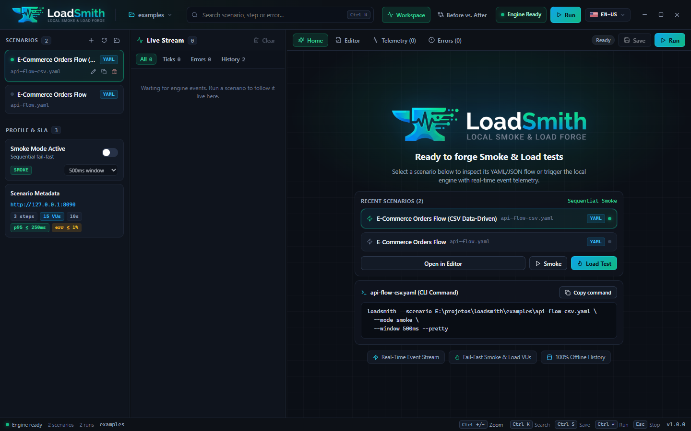
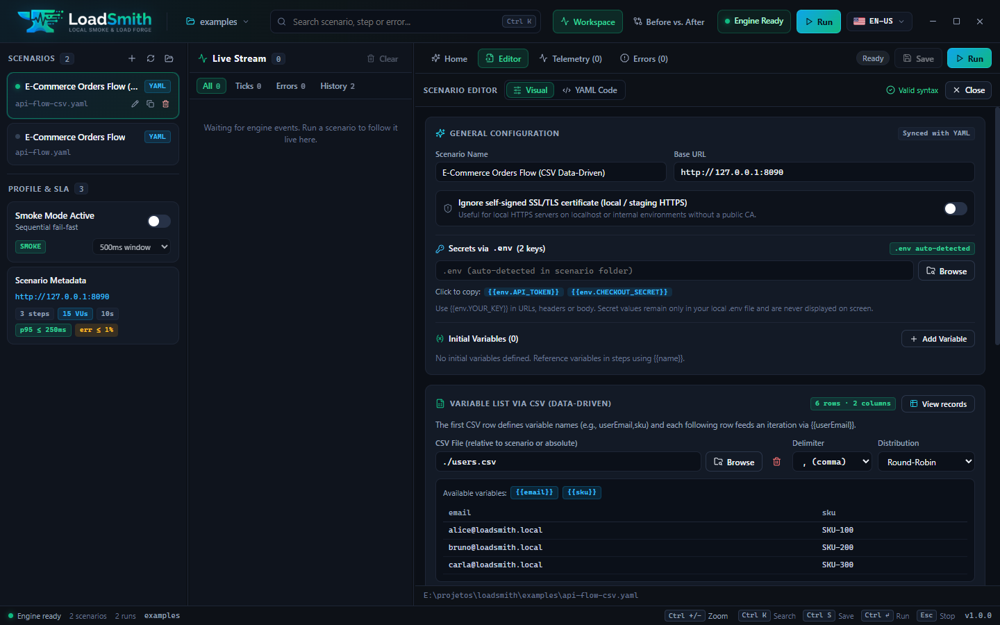
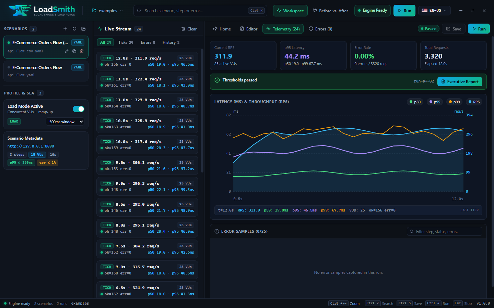
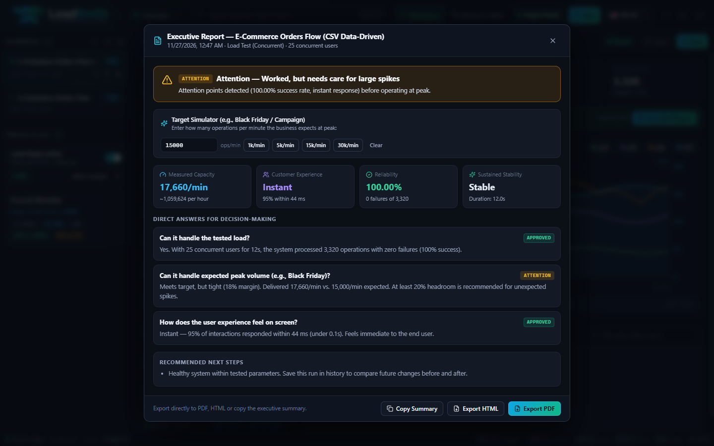

<p align="center">
  
</p>

<p align="center">
  <strong>Local Smoke &amp; Load Forge — Plataforma 100% Offline de Testes de Fluxo, Carga e Decisão Executiva</strong>
</p>

<p align="center">
  <a href="https://github.com/claudsan/loadsmith/actions/workflows/ci.yml"></a>
  <a href="https://github.com/claudsan/loadsmith/actions/workflows/release.yml"></a>
  <a href="https://github.com/claudsan/loadsmith/actions/workflows/pages.yml"></a>
  <a href="LICENSE"></a>
  
</p>

<p align="center">
  🌐 <a href="README.md">English</a> · <strong>Português</strong> · <a href="README.es-ES.md">Español</a>
  <br />
  🚀 <a href="https://claudsan.github.io/loadsmith/"><strong>Site Oficial &amp; Simulador Interativo</strong></a> · 🔥 App Irmão: <a href="https://claudsan.github.io/hooksmith/"><strong>Hooksmith</strong></a>
</p>

# LoadSmith — Manual de Uso

O **LoadSmith** é um aplicativo de desktop que responde às três perguntas que toda equipe faz antes de um grande lançamento:

- *Nosso sistema aguenta a carga?*
- *Aguenta a volumetria que esperamos?*
- *Vai cair na Black Friday?*

Ele roda no seu próprio computador, funciona offline, mantém seus dados locais e fala em linguagem clara — para que tanto desenvolvedores quanto gestores entendam os resultados.

> 📖 Procurando a documentação técnica/para desenvolvedores? Veja [docs/DEVELOPMENT.md](docs/DEVELOPMENT.md) (em inglês).

---

## Sumário

1. [Instalação](#1-instalação)
2. [Seu primeiro teste em 5 minutos](#2-seu-primeiro-teste-em-5-minutos)
3. [Conhecendo a tela](#3-conhecendo-a-tela)
4. [Criando e editando cenários](#4-criando-e-editando-cenários)
5. [Variáveis, arquivos CSV e segredos](#5-variáveis-arquivos-csv-e-segredos)
6. [Teste Smoke vs. teste de Carga](#6-teste-smoke-vs-teste-de-carga)
7. [Lendo os resultados](#7-lendo-os-resultados)
8. [Histórico e Antes vs. Depois](#8-histórico-e-antes-vs-depois)
9. [O Relatório Executivo (para gestores)](#9-o-relatório-executivo-para-gestores)
10. [Idioma, atalhos e dicas](#10-idioma-atalhos-e-dicas)
11. [Solução de problemas](#11-solução-de-problemas)
12. [App Irmão — Hooksmith](#12-app-irmão--hooksmith)

---

## 1. Instalação

O LoadSmith está disponível para **Windows**, **macOS** e **Linux**:

| Plataforma | Pacote | Quando usar |
| --- | --- | --- |
| **Windows (x64)** | `LoadSmith Setup 1.0.0.exe` / `LoadSmith 1.0.0.exe` | Instalador padrão (atalhos no Menu Iniciar/Área de Trabalho) ou versão portátil. |
| **macOS (Apple Silicon & Intel)** | `LoadSmith-1.0.0-arm64.dmg` / `LoadSmith-1.0.0-x64.dmg` (`.zip`) | Pacote nativo macOS (arrastar para Aplicativos) com motor universal. |
| **Linux (x64)** | `LoadSmith-1.0.0.AppImage` / `loadsmith_1.0.0_amd64.deb` | `AppImage` universal (`chmod +x`) ou pacote `.deb` para Debian/Ubuntu. |

Baixe na página de **Releases** do projeto. Você **não** precisa instalar Go, Node.js ou qualquer outra coisa.

> **Aviso de aplicativo não assinado?** Clique em **Mais informações → Executar assim mesmo** no Windows SmartScreen, ou **Botão direito → Abrir** no macOS Gatekeeper.

Na primeira abertura, o LoadSmith cria a pasta **`Documents/LoadSmith`** com um cenário de exemplo, para você sempre ter algo para experimentar.

---

## 2. Seu primeiro teste em 5 minutos



1. **Abra o LoadSmith.** O cenário de exemplo aparece na coluna da esquerda.
2. **Aponte para a sua API.** Clique em **Editor** e informe a **Base URL** (por exemplo `https://homologacao.minhaempresa.com`).
3. **Confira os passos.** Cada passo é uma requisição (ex.: "fazer login", "criar pedido"). Ajuste os caminhos conforme a sua API.
4. **Clique em ▶ Executar.** Uma janela de confirmação mostra exatamente o que vai acontecer — endereço alvo, número de usuários, duração. Confirme para iniciar.
5. **Acompanhe ao vivo.** A aba **Telemetria** mostra velocidade, tempos de resposta e erros em tempo real.

Ao terminar, clique em **Relatório Executivo** para obter um resumo claro e fácil de compartilhar.

> 💡 **Dica:** comece sempre com uma execução **Smoke** (uma passada rápida pelo fluxo) para garantir que o cenário está correto e, depois, mude para **Carga**.

---

## 3. Conhecendo a tela

| Área | O que faz |
| --- | --- |
| **Barra superior** | Busca (`Ctrl K`), pasta do workspace atual, páginas **Workspace** / **Antes vs. Depois**, status do motor, botão **Executar** e seletor de idioma. |
| **Coluna esquerda — Cenários** | Seus arquivos de teste. Crie (**+**), atualize ou abra outra pasta. Passe o mouse sobre um cenário para **renomear**, **duplicar** ou **excluir**. |
| **Coluna esquerda — Perfil & SLA** | Alterne entre **Smoke** e **Carga**, escolha a janela de medição e veja o resumo do cenário selecionado. |
| **Coluna central — Live Stream** | Um fluxo ao vivo de tudo o que acontece durante a execução, além da aba **Histórico**. |
| **Área direita** | Abas: **Início**, **Editor**, **Telemetria** e **Erros**. |
| **Barra inferior** | Status do motor, quantidade de cenários e execuções, zoom e atalhos. |

Você pode arrastar as bordas das colunas para redimensioná-las. O app lembra do seu layout.

---

## 4. Criando e editando cenários

Um **cenário** é um teste salvo: *para onde* enviar as requisições, *o que* enviar e *o que conta como sucesso*.

### Criando um cenário

Clique em **+** acima da lista de cenários, digite um nome de arquivo (ex.: `checkout.yaml`) e escolha um modelo inicial:

- **API REST Simples** — um health check básico.
- **Login + Rota Autenticada** — faz login, guarda o token e o usa na próxima requisição.
- **Carga com Massa CSV** — usa uma planilha de usuários/produtos para que cada usuário virtual envie dados diferentes.

### O Editor Visual



Você nunca precisa escrever código. A aba **Visual** permite editar tudo com formulários; a aba **Código** mostra o mesmo cenário como texto, e ambas ficam sincronizadas.

Para cada **passo** você pode definir:

- **Método e Caminho** — ex.: `POST /orders`.
- **Headers** — ex.: um token de autorização.
- **Body** — os dados enviados (JSON ou texto simples).
- **Asserções** — o que precisa ser verdade: status esperado (ex.: `200`), texto que a resposta deve conter ou tempo máximo de resposta.
- **Extrair** — pegue um valor da resposta (como o token do login) e reutilize nos passos seguintes como `{{token}}`.

Use as setas para reordenar os passos e os ícones de copiar/lixeira para duplicar ou remover.

### Importando de um cURL

Já tem uma requisição no Chrome DevTools, Postman ou Insomnia? Copie como **cURL**, clique em **Importar cURL** na seção de Passos, cole, e o LoadSmith monta o passo para você — método, endereço, headers e body incluídos.

### Alterações não salvas

Se você tentar trocar de cenário, mudar de pasta ou fechar o app com edições não salvas, o LoadSmith pergunta se deseja **salvar**, **descartar** ou **cancelar**. Nada se perde por acidente.

---

## 5. Variáveis, arquivos CSV e segredos

### Variáveis iniciais
Defina valores simples (como `userEmail`) e use em qualquer lugar como `{{userEmail}}`.

### Dados em CSV (testes realistas)
Usuários reais são diferentes entre si. Vincule um **arquivo CSV** e cada usuário virtual pegará uma linha diferente.

- A **primeira linha** dá nome às variáveis (ex.: `email,sku`).
- Cada linha seguinte é um conjunto de valores.
- Use como `{{email}}` e `{{sku}}`.
- Escolha **Sequencial** (em ordem) ou **Aleatório**, e o separador de colunas (vírgula, ponto e vírgula ou tab).
- Clique em **Visualizar registros** para navegar e pesquisar no arquivo, e clique no chip de uma variável para copiá-la.

### Segredos com arquivo `.env`
Nunca digite senhas ou chaves de API direto no cenário. Coloque-as em um arquivo chamado `.env` ao lado do seu cenário:

```
API_TOKEN=meu-valor-secreto
```

O LoadSmith detecta o arquivo automaticamente e mostra os **nomes** dos seus segredos como chips clicáveis, como `{{env.API_TOKEN}}`. Os **valores nunca aparecem na tela** e nunca são gravados no cenário.

### HTTPS com certificado autoassinado
Testando um servidor local ou interno com certificado próprio? Ative **Ignorar certificado SSL/TLS autoassinado**. Use apenas em ambientes de confiança.

---

## 6. Teste Smoke vs. teste de Carga

| | **Smoke** | **Carga** |
| --- | --- | --- |
| **Objetivo** | "Meu fluxo funciona?" | "Ele aguenta muitos usuários?" |
| **Como executa** | Um usuário, passo a passo. Para na primeira falha. | Vários usuários virtuais ao mesmo tempo. |
| **Duração** | Poucos segundos | Você decide |

Configurações de carga:

- **Virtual Users (VUs)** — quantos usuários simulados agem ao mesmo tempo.
- **Duração** — quanto tempo o teste dura (ex.: `30s`, `5m`).
- **Ramp-Up** — com que gradualidade os usuários chegam (ex.: `10s`), como uma multidão entrando numa loja.
- **Think Time** — uma pausa entre as ações de cada usuário, para se comportar como uma pessoa.

### Regras de aprovação (SLA)
Defina limites e o LoadSmith marca automaticamente o teste como **Aprovado** ou **Falhou**:

- **p95 máximo** — 95% das requisições precisam ser mais rápidas que isso (em milissegundos).
- **Taxa de erro máxima** — o maior percentual de falhas que você aceita.

---

## 7. Lendo os resultados



| Número | O que significa em palavras simples |
| --- | --- |
| **RPS** | Requisições por segundo — o quão ocupado o sistema está. |
| **p50** | O tempo de resposta típico — metade das requisições é mais rápida. |
| **p95** | Quase o pior caso — 95% das requisições são mais rápidas. O melhor número para julgar a experiência do usuário. |
| **p99** | Pior caso realista — só 1% das requisições é mais lenta. |
| **Taxa de erro** | Percentual de requisições que falharam. |
| **VUs** | Usuários simulados ativos neste momento. |

A aba **Erros** guarda amostras das falhas (até 25), com passo, requisição, status e mensagem — úteis para achar onde as coisas quebram.

---

## 8. Histórico e Antes vs. Depois

Toda execução é salva automaticamente no seu computador.

1. Abra **Antes vs. Depois** na barra superior.
2. Escolha uma execução **Antes** (referência) e uma **Depois** (alvo).
3. Veja como tempo de resposta, vazão, erros e total de requisições mudaram — **verde é melhor, vermelho é pior** — além de um gráfico sobreposto.

Perfeito para provar que uma otimização funcionou (ou que uma versão deixou tudo mais lento).

---

## 9. O Relatório Executivo (para gestores)



Depois de qualquer execução, clique em **Relatório Executivo**. Ele traduz os números para linguagem de negócio:

- Um **veredito em semáforo**: Aprovado, Atenção ou Risco Alto.
- **Respostas diretas** para: *Aguenta a carga? Aguenta a volumetria esperada? Como fica a experiência do cliente?*
- **Cartões de negócio**: capacidade por minuto/hora, experiência do cliente, confiabilidade e estabilidade.
- **Próximos passos recomendados**.

### O simulador de Black Friday
Informe quantas operações por minuto o seu negócio espera no pico (ou use os atalhos 1k / 5k / 15k / 30k). O relatório diz se o sistema atinge a meta, qual a folga ou o quanto falta.

### Compartilhando
- **Exportar PDF** — um clique, pronto para enviar por e-mail.
- **Exportar HTML** — abre em qualquer navegador.
- **Copiar Resumo** — texto simples para chats e e-mails.

O relatório segue o idioma selecionado.

---

## 10. Idioma, atalhos e dicas

### Idioma
Use o seletor com bandeiras na barra superior para alternar entre **English**, **Português** e **Español**. O LoadSmith lembra da sua escolha.

### Atalhos de teclado

| Atalho | Ação |
| --- | --- |
| `Ctrl` + `K` | Buscar cenários, passos e erros |
| `Ctrl` + `S` | Salvar o cenário aberto |
| `Ctrl` + `Enter` | Executar (pede confirmação antes) |
| `Esc` | Parar um teste em andamento / fechar uma janela |
| `Ctrl` + `+` / `-` / `0` | Aumentar / diminuir / restaurar zoom |

### Boas práticas
- Comece com **Smoke** e depois **Carga**.
- Aumente os usuários gradualmente entre as execuções para achar o ponto de ruptura.
- Teste em **homologação**, não em produção, a menos que saiba exatamente o que está fazendo — um teste de carga pode realmente deixar o sistema alvo lento.
- Rode o mesmo cenário antes e depois de uma mudança e compare em **Antes vs. Depois**.

---

## 11. Solução de problemas

| Problema | O que fazer |
| --- | --- |
| **"Motor não encontrado" / botão Executar desabilitado** | Reinstale o app. O motor de testes vem embutido nele. |
| **Tudo falha com erro de SSL/certificado** | O servidor usa certificado autoassinado. Ative a opção de certificado autoassinado (apenas em ambientes de confiança). |
| **"undefined variable"** | Um `{{nome}}` está sem valor. Verifique a grafia, o cabeçalho do CSV, a chave do `.env` ou se um passo anterior a extrai. |
| **Erro de sintaxe no Editor Visual** | Abra a aba **Código**, corrija a linha destacada e volte para **Visual**. |
| **O Windows SmartScreen bloqueia o instalador** | Clique em **Mais informações → Executar assim mesmo**. |

---

## 12. App Irmão — Hooksmith

O **LoadSmith** possui um aplicativo irmão construído com a mesma filosofia local-first, sem nuvem e em 3 idiomas:

🔥 **[Hooksmith — Local API & Webhook Forge](https://claudsan.github.io/hooksmith/?lang=pt)** ([Repositório no GitHub](https://github.com/claudsan/hooksmith))

- Abra **listeners HTTP & HTTPS** locais com emissão automática de certificado SSL autoassinado.
- Inspecione chamadas recebidas, crie **Regras de Mock** com atraso configurável e dispare **callbacks assíncronos automatizados**.
- **Combo perfeito:** simule gateways externos no **Hooksmith** durante o desenvolvimento e use o **LoadSmith** para validar o fluxo ponta a ponta e medir a capacidade sob carga 100% offline.

---

## Licença

MIT — veja [LICENSE](LICENSE). As notas de versão estão em [CHANGELOG.md](CHANGELOG.md).
